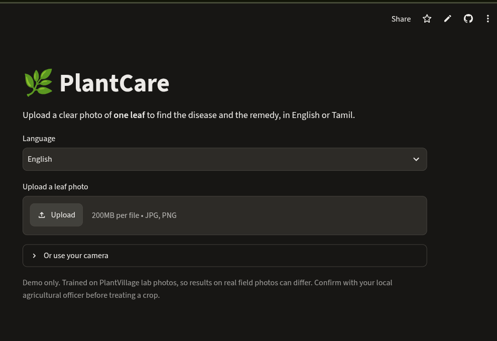
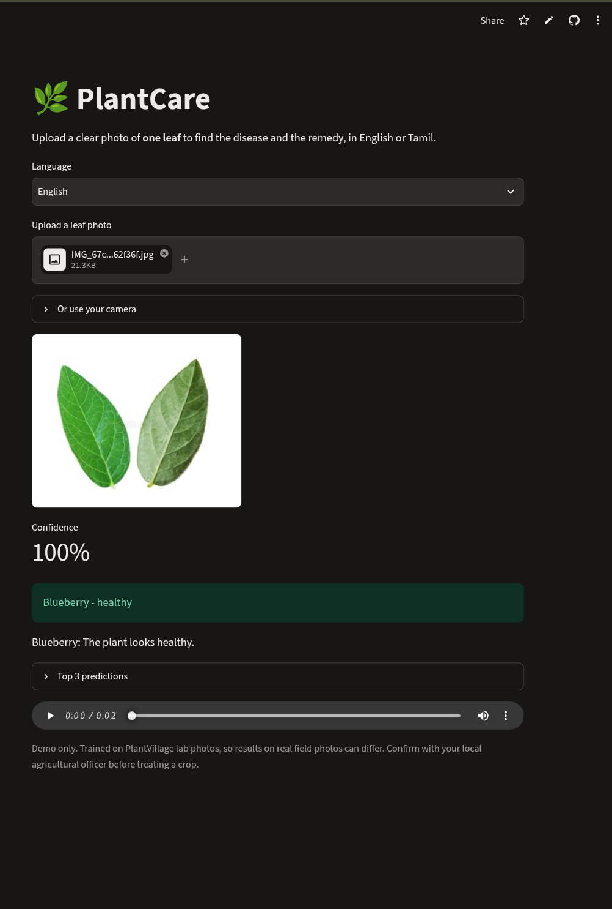
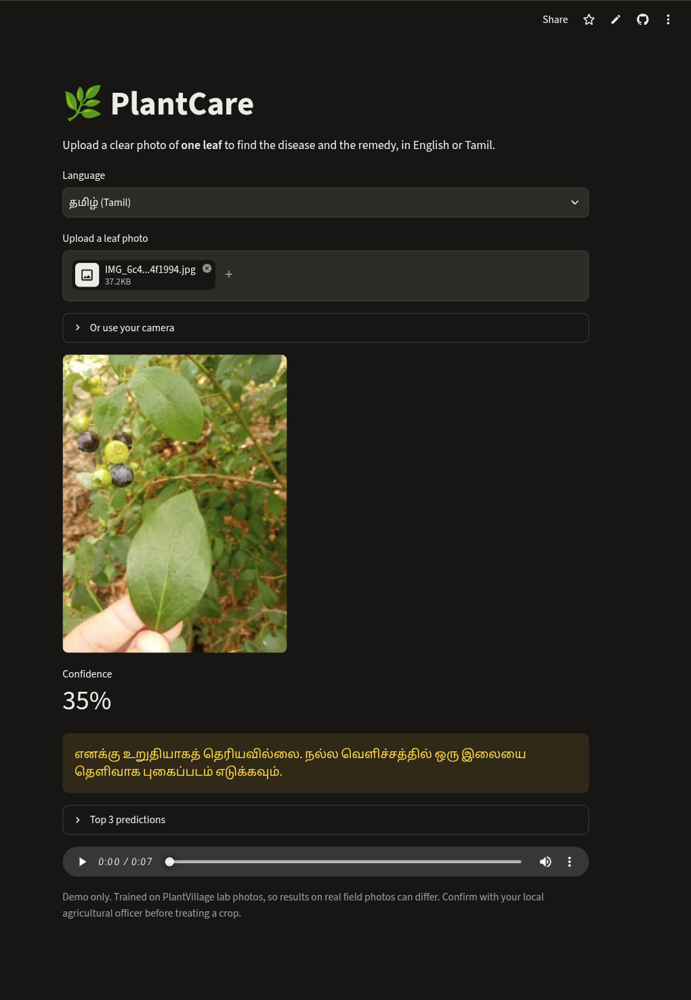

# 🌿 PlantCare: Crop Disease Detection

A farmer photographs a leaf, and the app names the disease and gives a remedy in English or Tamil, with voice. The model is small enough (2.7 MB) to run on a phone without internet.

Built for Smart India Hackathon 2026 (problem statement SIH26131: early detection and management of crop diseases and pest infestations) by Team Techxorcist.

**▶ Live demo:** https://plantcare-78fojlbcmn6wa55an5pipa.streamlit.app *(upload a leaf photo and try it)*

[](https://colab.research.google.com/github/Karthi248/plantcare/blob/main/PlantCare_Training.ipynb)

## Screenshots

<table>
<tr>
<td></td>
<td></td>
<td></td>
</tr>
<tr>
<td align="center">Choose English or Tamil and upload a leaf photo</td>
<td align="center">Clear leaf: high confidence, result and voice in English</td>
<td align="center">Real field photo: low confidence, so the app asks for a clearer photo, in Tamil</td>
</tr>
</table>

The right-hand screenshot is the confidence check at work. Below 60% confidence, the app does not guess a disease. It asks the farmer to take a clearer photo.

## The problem

- Farmers lose 15–30% of yield to diseases found too late
- Many rural and elderly farmers cannot use English-only apps
- Expert help often means waiting for an agricultural officer's visit

## How it works

```
Leaf photo → MobileNetV2 (TensorFlow Lite) → confidence check → remedy lookup → text + voice
```

1. A MobileNetV2 model classifies the leaf into one of 38 plant and disease classes
2. If confidence is below 60%, the app asks for a clearer photo instead of guessing
3. The remedy and prevention tips come from a local file (`remedies.json`), so no internet is needed for the diagnosis
4. The result is shown in English or Tamil and read aloud

## The model

- **Data:** PlantVillage, 54,000+ leaf images in 38 classes, split 80% train, 10% validation, 10% test
- **Architecture:** frozen MobileNetV2 (ImageNet weights, transfer learning) → global average pooling → Dense 128 → Dropout 0.3 → softmax
- **Class imbalance:** the biggest class has 36 times more images than the smallest, so training uses class-weighted loss instead of copying images
- **Augmentation:** random flip, rotation and zoom on training images
- **Training:** 8 epochs on a Colab T4 GPU. The full run is in `PlantCare_Training.ipynb`.

## Results

| | Accuracy |
|---|---|
| Test set (never seen during training) | **91.29%** |
| TensorFlow Lite model, 300 test images | 92.0% |

The converted model is 2.7 MB.

## Limitations

- PlantVillage photos are mostly lab-style leaves on plain backgrounds, and one leaf can appear in several photos. Accuracy on real field photos, with different light, backgrounds and damaged leaves, is **not tested yet**.
- Only the crops in PlantVillage are covered. Crops like rice, cotton and sugarcane are not.
- The remedies in `remedies.json` are examples for a few diseases. Check them against ICAR agro-advisories or an agricultural expert before real use. Tamil text should be checked by native speakers.
- Voice in this web demo uses Google text-to-speech, which needs internet. A phone app would use the phone's own text-to-speech to work fully offline.
- This is a demo, not a replacement for an agricultural officer.

## Next steps

- Test and retrain with real Indian field photos
- Add crops such as rice, cotton and sugarcane
- Add more languages, checked by native speakers and experts
- Build the Android app with on-device voice

## Run it yourself

```bash
pip install -r requirements.txt
streamlit run app.py
```

## Files

- `app.py`: web demo
- `predictor.py`: offline prediction, confidence check and remedy lookup
- `plantcare.tflite`: trained model
- `labels.json`: the 38 class names
- `remedies.json`: remedy text (English and Tamil examples)
- `PlantCare_Training.ipynb`: training notebook (Google Colab)

## References

- Hughes & Salathé (2015), PlantVillage dataset
- Sandler et al. (2018), MobileNetV2, CVPR
- ICAR Kharif agro-advisories for farmers
- FAO Integrated Pest Management

## Team Techxorcist

- Karthick K (Team Leader)
- Keerthana
- VarumLakshmi M
- Mytheeswari G
- Srikanth S
- Vasanth P
